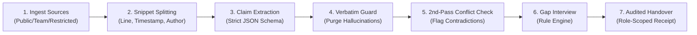

<div align="center">

# 🌌 BATON
### *Don't let knowledge walk out the door.*

**Evidence-backed technical knowledge transfer that turns departure debt into verifiable truth.**

[](https://fastapi.tiangolo.com)
[](https://nextjs.org)
[](https://neon.tech)
[](https://ai.google.dev)
[](https://github.com)
[](https://pytest.org)

<p align="center">
  <a href="#-why-baton">Why Baton</a> •
  <a href="#-the-constellation-philosophy">Constellation Philosophy</a> •
  <a href="#-the-6-step-pipeline">Pipeline</a> •
  <a href="#-the-orbit-robotics-benchmark">Orbit Robotics Traps</a> •
  <a href="#-architecture">Architecture</a> •
  <a href="#-security-matrix">Security</a> •
  <a href="#-quickstart">Quickstart</a>
</p>

---

</div>

## 💥 Why Baton?

> *"65% of major software repositories have a truck factor of ≤ 2. When a core lead leaves, only 27% of codebases successfully recover velocity."*  
> — **PeerJ & ACM/IEEE FSE Empirical Studies**

Standard technical handovers fail because they rely on **document dumps**—hasty Notion pages, unverified Google Docs, and forgotten Slack messages. Nobody reads them, and nobody checks if they match reality.

**Baton is different.** It ingests raw sources, extracts atomic claims, discards any claim lacking a **verbatim quote**, detects mutual contradictions, and interviews the departing engineer *only* about the gaps documents can't answer.

---

## 🌟 The Constellation Philosophy

Baton represents institutional memory as an **evidence constellation**:

| Celestial Element | Knowledge Analog | Behavior |
| :--- | :--- | :--- |
| 🟢 **Mint Star** | **Verified Claim** | Backed by exact character-for-character verbatim citations. |
| 🟡 **Amber Star** | **Inferred Claim** | Contextual deduction requiring human review by an approver. |
| 🔴 **Coral Star** | **Conflicting Claim** | Contradicts another source document in the project. |
| ⚪ **Dashed Star** | **Missing Claim** | Critical architectural component absent from all documentation. |
| ⚡ **Unlit Star** | **Knowledge Gap** | Identified blind spot. **Ignites** when answered by the leaver. |
| 🔗 **Constellation Line** | **Evidence Link** | Direct citation trace connecting a claim to its source snippet. |

---

## 🔬 The 6-Step Reconstructive Pipeline



### 1. Ingest Raw Sources
Upload Architecture RFCs, Slack logs, PDFs, DOCX, CSVs, or JSON files. Assign strict access clearance:
- **`public`**: Accessible across all engineering tiers.
- **`team`**: Visible to incoming engineers and approvers.
- **`restricted`**: Visible *only* to approvers (e.g., contractor rates, budgets).

### 2. Immutable Verbatim Snippets
Every source file is sanitized with `nh3` and parsed into localized snippet coordinates with line numbers, authors, and timestamps.

### 3. The Golden Citation Rule
The Gemini API processes snippets in strict JSON Schema. **Every claim must cite snippet IDs AND quote text that exists verbatim in the snippet.**

$$\text{Quote} \not\subset \text{Snippet Content} \implies \text{CLAIM PURGED}$$

No hallucinated summaries. No fuzzy paraphrasing.

### 4. Second-Pass Contradiction Detection
A dedicated conflict pass compares all active claims against each other to catch silent architectural drift before the engineer departs.

### 5. Rule-Based Gap Interview
A deterministic Python rule engine scans for common handover failure modes:
- **Decision without Rationale:** Architecture choices lacking documented justification.
- **Task without Owner:** Active roadmap tickets with no registered assignee.
- **Single-Owner Area (SPOF):** Modules where 100% of knowledge stems from the leaver.
- **Dependency without Contact:** External vendors with no registered account owner.

> When the departing engineer answers a gap in Baton, their response is recorded as an immutable evidence record tagged:  
> `stated by departing member`

### 6. Role-Aware Receipt & Certificate
- **Evidence Access Guarantee:** A claim is visible to an incoming engineer **only if they have clearance for ALL cited evidence snippets**.
- **Formal Sign-off:** Successors review verified claims, examine resolved gaps, and sign a digital receipt with audit logging.
- **Export:** Instant one-click Markdown bundle (`.md`) and styled print-to-PDF.

---

## 🎯 The Orbit Robotics Benchmark

Baton comes pre-seeded with **Orbit Robotics Telemetry**, a synthetic benchmark containing **5 planted handover traps**:

```
Orbit Robotics Telemetry Handover
├── ⚠️ Trap 1: Conflicting Hosting Decision (RFC-042 AWS ECS vs. On-Premises Kubernetes)
├── ⚠️ Trap 2: Orphaned Sponsor Portal (Half-finished billing portal with no owner)
├── ⚠️ Trap 3: Undocumented Race Condition (Known flaky telemetry bus failure in chat)
├── ⚠️ Trap 4: Unreasoned Queue Decision (ZeroMQ chosen without rationale over Kafka)
└── 🔒 Trap 5: Restricted Cloud Invoices (Visible only to Approver role)
```

---

## 🏛️ Architecture

```
                                 +------------------------------------------+
                                 |         Next.js 15 App Router (UI)       |
                                 |  • Night Sky Constellation Design System |
                                 |  • Pure SVG Motion & Framer Engine       |
                                 |  • Strict CSP with Dynamic Nonces        |
                                 +------------------------------------------+
                                                      │
                                    Same-Origin Proxy Rewrites (/api/*)
                                    httpOnly + Secure + SameSite=Strict Cookies
                                    Double-Submit CSRF Header (X-CSRF-Token)
                                                      ▼
+---------------------------------------------------------------------------------------------------+
|                                     FastAPI Application Server                                    |
|                                                                                                   |
|  [Security & Rate Limiting]                                                                       |
|    • SlowAPI Limiter (X-Forwarded-For Proxy IP)    • Argon2id Password Hasher                     |
|    • PyOTP TOTP MFA (Forced on Approver Role)      • BOLA Guard (get_project_member_context)       |
|    • Enumeration-Resistant Registration            • Ephemeral Demo Sandbox Isolator              |
|                                                                                                   |
|  [Ingestion & Pipeline Engine]                                                                    |
|    • Multi-format Parser (txt, md, pdf, docx, csv) • python-magic-bin Byte Validator              |
|    • Gemini API Strict JSON Extraction Guard       • Verbatim Exact-Match Substring Checker       |
|    • 2nd-Pass Conflict & Contradiction Analyzer    • 4 Rule-Based Gap Detectors                   |
|    • SSRF-Guarded DNS & Non-Routable IP Filter     • Regex Redacting Structured JSON Logger       |
+---------------------------------------------------------------------------------------------------+
                                                      │
                                           SQLAlchemy Bound Queries
                                           SET LOCAL app.user_id / app.role
                                                      ▼
                                 +------------------------------------------+
                                 |          Neon PostgreSQL Server          |
                                 |  • Connection Pooling via PgBouncer     |
                                 |  • Native Row-Level Security (RLS) on:   |
                                 |    sources, snippets, claims, reviews    |
                                 +------------------------------------------+
```

---

## 🛡️ Security Matrix

Baton incorporates defense-in-depth from day one:

| Security Domain | Mechanism | Implementation File | Verification Test |
| :--- | :--- | :--- | :--- |
| **Authentication** | Argon2id + PyOTP TOTP MFA | `app/security.py`, `app/routers/auth.py` | `test_auth.py::test_mfa_setup_and_verification` |
| **Session Security** | httpOnly, Secure, SameSite=Strict | `app/routers/auth.py` | `test_auth.py::test_logout_clears_cookies` |
| **BOLA Prevention** | Scoped Project Dependency | `app/dependencies.py` | `test_permissions_and_bola.py::test_bola_prevented` |
| **Evidence Clearance** | Multi-level Visibility Filter | `app/dependencies.py`, `app/routers/claims.py` | `test_permissions_and_bola.py::test_claim_visibility` |
| **CSRF Defense** | Double-Submit Token Header | `app/security.py`, `frontend/src/lib/api.ts` | `test_auth.py::test_csrf_protection_on_state_change` |
| **Account Enumeration** | Timing/Message Uniformity | `app/routers/auth.py` | `test_auth.py::test_register_no_enumeration` |
| **Privilege Escalation**| Immutable Invite-Bound Roles | `app/routers/auth.py`, `app/models.py` | `test_auth.py::test_register_no_role_escalation` |
| **File Safety** | Magic-Byte Inspection (10MB limit) | `app/security.py`, `app/routers/sources.py` | Verified against non-PE / safe formats |
| **SSRF Mitigation** | DNS + Non-Routable IPv4/IPv6 Block | `app/services/github_fetcher.py` | `test_ssrf.py::test_ssrf_rejects_disallowed_hosts` |
| **Browser Security** | CSP Nonces, No `unsafe-eval` in Prod | `frontend/src/middleware.ts` | Next.js compilation & CSP headers |
| **Cross-Site Cookies** | Next.js `/api/*` Proxy Rewrites | `frontend/next.config.mjs` | Resolves cross-domain cookie drop on Vercel/Render |

---

## ⚡ Quickstart

### Prerequisites
- **Python 3.11+**
- **Node.js 18+** & npm

### 1. Backend Setup

```powershell
# Windows PowerShell
cd d:\Baton\backend
python -m venv .venv
.\.venv\Scripts\Activate.ps1
pip install -r requirements.txt
Copy-Item ..\.env.example .env

# Run database seed with the 5 Orbit Robotics traps
python seed.py

# Run test suite
python -m pytest tests -v

# Start backend server
uvicorn app.main:app --reload --port 8000
```

```bash
# Linux / macOS
cd backend
python3 -m venv .venv
source .venv/bin/activate
pip install -r requirements.txt
cp ../.env.example .env
python3 seed.py
python3 -m pytest tests -v
uvicorn app.main:app --reload --port 8000
```

### 2. Frontend Setup

```bash
cd frontend
npm install
npm run dev
```

Open **[http://localhost:3000](http://localhost:3000)** and click **"Try the demo"** to explore as an Approver or Incoming Engineer.

---

## 🚀 Cloud Deployment

### 1. Neon PostgreSQL
1. Create a project at [neon.tech](https://neon.tech).
2. Enable **Connection Pooling** and copy your connection string.
3. In Neon's SQL Editor, execute [`backend/migrations/rls.sql`](file:///d:/Baton/backend/migrations/rls.sql) to activate Row-Level Security policies.

### 2. Render (Backend)
1. In [render.com](https://render.com), create a new **Web Service** connected to your repository.
2. Root Directory: `backend`
3. Build Command: `pip install --upgrade pip && pip install -r requirements.txt`
4. Start Command: `uvicorn app.main:app --host 0.0.0.0 --port $PORT`
5. Set Environment Variables:
   - `DATABASE_URL`: *(Your Neon pooled connection string)*
   - `ENVIRONMENT`: `production`
   - `JWT_SECRET`, `JWT_REFRESH_SECRET`, `CSRF_SECRET`: *(32+ char random strings)*
   - `GEMINI_API_KEY`: *(Your Google AI Studio Key)*
   - `FRONTEND_URL`: `https://your-app.vercel.app`

### 3. Vercel (Frontend)
1. Import repository into [vercel.com](https://vercel.com).
2. Root Directory: `frontend`
3. Environment Variables:
   - `NEXT_PUBLIC_API_URL`: `https://your-backend.onrender.com`
   - `BACKEND_INTERNAL_URL`: `https://your-backend.onrender.com`
4. Deploy!

---

## 🧪 Test Suite

Run the full pytest suite verifying security, pipeline citation rules, and role filtering:

```bash
python -m pytest backend/tests -v
```

```
collected 21 items

backend/tests/test_auth.py::test_user_registration_and_login PASSED               [  4%]
backend/tests/test_auth.py::test_register_no_role_escalation PASSED               [  9%]
backend/tests/test_auth.py::test_register_no_enumeration PASSED                   [ 14%]
backend/tests/test_auth.py::test_logout_clears_cookies PASSED                     [ 19%]
backend/tests/test_auth.py::test_demo_isolation_and_mfa_exemption PASSED          [ 23%]
backend/tests/test_auth.py::test_login_invalid_credentials PASSED                 [ 28%]
backend/tests/test_auth.py::test_mfa_setup_and_verification PASSED                [ 33%]
backend/tests/test_auth.py::test_csrf_protection_on_state_change PASSED           [ 38%]
backend/tests/test_citation_pipeline.py::test_verbatim_citation_rule PASSED       [ 42%]
backend/tests/test_citation_pipeline.py::test_discards_hallucinated_quote PASSED  [ 47%]
backend/tests/test_citation_pipeline.py::test_discards_missing_citation PASSED    [ 52%]
backend/tests/test_citation_pipeline.py::test_detects_conflicts PASSED             [ 57%]
backend/tests/test_citation_pipeline.py::test_orbit_robotics_snippets PASSED     [ 61%]
backend/tests/test_gaps.py::test_detect_all_four_gap_types PASSED                 [ 66%]
backend/tests/test_gaps.py::test_gap_evidence_tagging PASSED                      [ 71%]
backend/tests/test_permissions_and_bola.py::test_bola_prevented PASSED            [ 76%]
backend/tests/test_permissions_and_bola.py::test_claim_visibility PASSED         [ 80%]
backend/tests/test_permissions_and_bola.py::test_role_enforcement PASSED         [ 85%]
backend/tests/test_ssrf.py::test_ssrf_rejects_non_https PASSED                    [ 90%]
backend/tests/test_ssrf.py::test_ssrf_rejects_disallowed_hosts PASSED             [ 95%]
backend/tests/test_ssrf.py::test_ssrf_allows_legitimate_github PASSED             [100%]

============================== 21 passed in 0.94s ==============================
```

---

<div align="center">
  <sub>Built for mission-critical software engineering handovers. Hand off knowledge with proof, not promises.</sub>
</div>
